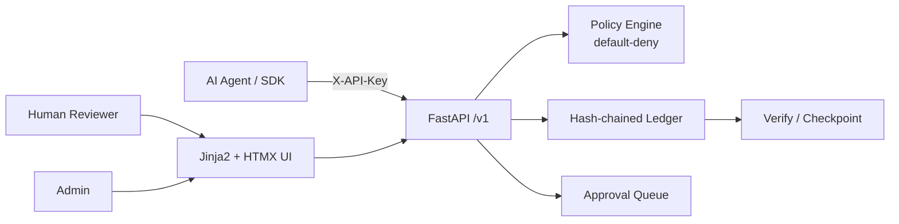

# AgentWarden

**AI Agent Governance and Human Accountability System**

AI agents are being given real authority (refunds, emails, data access), but nobody can reliably say: was this action allowed, under which rule, which human is responsible, and can the record be trusted?

AgentWarden is a governance layer that sits between AI agents and the tools they use. Before an agent performs a risky action it asks AgentWarden. A deterministic, default-deny policy engine answers **ALLOW**, **DENY**, or **REQUIRE_APPROVAL**. Risky requests wait in a human reviewer queue. Every event is written to an append-only, hash-chained ledger that anyone can re-verify, and every agent has a named human owner. Approvers must give a written reason, and nobody can approve their own agent's actions.

> Built for CodeX 3.0 (problem statement: AI Agent Governance and Human Accountability System).

**Screenshots:** *(placeholders until Phase 2 UI is complete)*

---

## Quickstart

```bash
# Clone / enter repo
cd agentwarden

# Install (Python 3.12+)
python3 -m venv .venv
source .venv/bin/activate
pip install -r requirements.txt
pip install -e .

# Copy env and run
cp .env.example .env
make run          # or: uvicorn app.main:app --reload --port 8000

# In another terminal
curl http://localhost:8000/health
# {"status":"ok","app":"AgentWarden","version":"0.1.0","db":"ok","ledger_head_seq":null}
```

```bash
make test   # pytest
make lint   # ruff
```

---

## Architecture



- **Policy engine** is pure and deterministic (no DB, no I/O). Lowest priority matching rule wins; unmatched → DENY.
- **Ledger** is append-only with SHA-256 hash chaining and concurrent-safe head locking.
- **Separation of duties**: agent owners cannot approve their own agents' requests.
- No LLM ever makes or changes a decision. Optional Anthropic key only rewords plain-language summaries.

---

## Handoff: Read This First

### Project summary for a fresh LLM

AgentWarden is a FastAPI governance layer for AI agents: policy engine (ALLOW/DENY/REQUIRE_APPROVAL), human approval queue, append-only hash-chained ledger, named human owners per agent. Stack: Python 3.12, FastAPI, SQLAlchemy 2, Alembic, Jinja2+HTMX+Tailwind (CDN), SQLite default / Postgres via DATABASE_URL. Non-negotiable: no LLM decisions, default-deny, no fake data in app code, no placeholders/TODOs, tests must pass, scope is the feature list only. Run from repo root with PYTHONPATH=. or after `pip install -e .`.

### Current status

- Current phase: **0**
- Last updated: 2026-10-10 ~21:30 IST
- Overall: Skeleton only. Repo structure, config, DB (SQLite + Alembic), Makefile targets, CI workflow, `/health` endpoint, basic tests. No policy/ledger/auth/UI yet.
- Tests: **2 passed** (`PYTHONPATH=. python3 -m pytest -v`)
- `make verify`: not yet implemented (Phase 3)

### Feature checklist

| Feature | Status | Where in code | How to check it |
|---------|--------|---------------|-----------------|
| Repo structure / config / Makefile | done and tested | `app/config.py`, `Makefile`, `pyproject.toml` | `make help`; `curl /health` |
| DB engine + Alembic | done and tested | `app/db.py`, `alembic/` | tables created on startup; migration exists |
| `/health` | done and tested | `app/main.py` | `GET /health` → 200 + db ok |
| Policy engine | not started | `app/policy/engine.py` | — |
| Ledger | not started | `app/ledger.py` | — |
| Agent auth + actions API | not started | `app/api/` | — |
| Approvals + separation of duties | not started | `app/services/` | — |
| Escalation task | not started | `app/services/escalation.py` | — |
| Simulator | not started | `app/policy/simulator.py` | — |
| Human auth / CSRF / RBAC | not started | `app/security.py` | — |
| UI pages | not started | `app/web/` | — |
| Seed / Demo Lab / SDK / smoke | not started | `scripts/`, `sdk/` | — |
| Docker + Postgres | skeleton only | `Dockerfile`, `docker-compose.yml` | not fully exercised yet |

### How to run, test, and demo

```bash
# Setup
python3 -m venv .venv && source .venv/bin/activate
pip install -r requirements.txt && pip install -e .
cp .env.example .env

# Run
make run                    # uvicorn on :8000
# or: PYTHONPATH=. uvicorn app.main:app --reload --port 8000

# Test / lint
PYTHONPATH=. python3 -m pytest -v
PYTHONPATH=. ruff check --no-cache app tests scripts sdk
PYTHONPATH=. ruff format --check --no-cache app tests scripts sdk

# Seed / demo / verify → Phase 3
# Docker → make docker-up (app + Postgres)
```

### Decisions and Assumptions

1. Phase 0 uses a minimal `HealthCheck` model so `create_all` / Alembic have a real table; full domain models arrive in Phase 1.
2. Alembic is preferred over bare `create_all`; startup still calls `init_db()` for convenience in dev/tests.
3. SQLite is the default; `DATABASE_URL` switches to Postgres without code changes.
4. Makefile targets `seed`/`demo`/`verify` intentionally exit 1 until Phase 3 implements them.
5. Packages installed system/user-wide in this environment when venv creation failed; production path uses `.venv` as documented.

### Known issues and limitations

- No domain models, policy, ledger, auth, or UI yet (by design for Phase 0).
- `make setup` expects a working venv; some sandboxed environments need `PYTHONPATH=.` and user-site packages.
- Ledger head seq is `null` until Phase 1.
- Docker Compose not yet smoke-tested end-to-end.

### Next steps (ordered)

1. **Phase 1 – Core engine**: full SQLAlchemy models (`User`, `Agent`, `Policy`, `ActionRequest`, `LedgerEntry`, `LedgerHead`); pure policy engine + condition types + tests; ledger append/verify/checkpoint + concurrency test; agent API-key auth; `/v1/actions/*`; kill switches; approval service with separation of duties; escalation background task; template summaries; policy simulator. All API-only.
2. Acceptance for Phase 1: all new tests green; curl walkthrough in README works.
3. Then Phase 2 (UI), Phase 3 (Demo), Phase 4 (Polish).

### Conventions

- Code style: ruff (line length 100, py312). Prefer explicit types.
- Naming: snake_case modules/functions, PascalCase models/schemas.
- New policy condition type: add to `app/policy/engine.py` evaluator + validation on policy save + unit tests.
- New ledger event type: add to allowed set in `app/ledger.py` + emit from the relevant service + test.
- New page (Phase 2+): router in `app/web/`, template under `app/web/templates/`, link in sidebar.

### Session log (append-only, newest last)

#### Session 1: 2026-10-10

- Goal: Complete Phase 0 (skeleton).
- What I changed (files and a one-line why for each):
  - `pyproject.toml`, `requirements.txt` – project metadata and dependencies
  - `.env.example`, `.gitignore`, `LICENSE` – env docs, ignore rules, MIT
  - `app/config.py`, `app/db.py`, `app/main.py`, `app/models.py` – settings, engine/session, FastAPI app + `/health`, minimal HealthCheck model
  - `app/schemas.py`, `app/security.py`, `app/policy/*`, `app/ledger.py`, `app/services/`, `app/api/`, `app/web/` – package placeholders
  - `alembic/` + initial migration – migrations preferred
  - `Makefile`, `Dockerfile`, `docker-compose.yml`, `.github/workflows/ci.yml` – build/run/CI
  - `tests/test_health.py`, `tests/conftest.py` – Phase 0 tests
  - `sdk/`, `scripts/` – placeholders for Phase 3
  - `README.md` – public docs + Handoff system
- What I ran and the real results:
  - `pip install` of requirements → success
  - `PYTHONPATH=. python3 -m pytest -v` → **2 passed**
  - `ruff check/format --no-cache` → all checks passed after format fix
  - `/health` via TestClient → `200 {"status":"ok","app":"AgentWarden","version":"0.1.0","db":"ok","ledger_head_seq":null}`
  - `alembic revision --autogenerate` → created `phase0_health_check` migration
- Decisions made: minimal HealthCheck model for Phase 0; Alembic + create_all on startup; Makefile stubs exit 1 for seed/demo/verify.
- Problems found and whether they are fixed:
  - venv creation failed in sandbox (permission on lib64) → used user-site install + PYTHONPATH; documented in Decisions.
  - ruff cache write failure → used `--no-cache`.
- Left unfinished: full domain models, policy, ledger, auth, UI, demo (all later phases).
- Next step for whoever continues: **Phase 1 – Core engine** (models, policy engine, ledger, actions API, approvals, escalation, simulator). Wait for user to say "continue to Phase 1".

---

## API examples

```bash
# Health (no auth)
curl -s http://localhost:8000/health | jq

# Full action/approval/policy/ledger examples arrive in Phase 1.
```

---

## Security notes and limitations

*(Expanded in Phase 4. Current Phase 0 notes:)*

- No authentication yet (Phase 1/2).
- Secrets must come from environment variables; never hard-code.
- The ledger will be **tamper-evident**, not tamper-proof. Agent self-declared sensitivity is a known limitation (honest disclosure required in final README).

---

## Credits and licenses

- MIT License (see `LICENSE`).
- Stack: FastAPI, SQLAlchemy, Alembic, Pydantic, argon2-cffi, Jinja2, HTMX, Tailwind CSS (CDN), Alpine.js (CDN), Chart.js (CDN), rich.
- No third-party application code reused yet.
