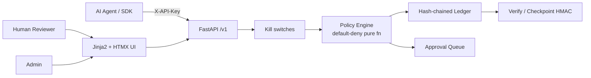

# AgentWarden

**AI Agent Governance and Human Accountability System**

AI agents are being given real authority (refunds, emails, data access), but nobody can reliably answer: *was this action allowed, under which rule, which human is responsible, and can the record be trusted?*

AgentWarden is a governance layer that sits between AI agents and the tools they use. Before an agent performs a risky action it asks AgentWarden. A **deterministic, default-deny** policy engine answers **ALLOW**, **DENY**, or **REQUIRE_APPROVAL**. Risky requests wait in a human reviewer queue. Every event is written to an **append-only, hash-chained ledger** that anyone can re-verify, and every agent has a **named human owner**. Approvers must give a written reason, and **nobody can approve their own agent's actions**.

Built for **CodeX 3.0** (problem statement: AI Agent Governance and Human Accountability System).

> **No LLM ever makes or changes a decision.** Rules decide. An optional Anthropic key may only reword plain-language summaries of pending requests. The app works fully without any API key.

---

## Quickstart

```bash
python3 -m venv .venv && source .venv/bin/activate
pip install -r requirements.txt && pip install -e .
cp .env.example .env

# Seed demo data (users, agents, policy, ~50 historical actions)
PYTHONPATH=. python scripts/seed.py --reset

# Run
uvicorn app.main:app --reload --port 8000
# → http://localhost:8000/login
```

| Email | Password | Role |
|-------|----------|------|
| admin@demo.local | demo-admin-pass | admin |
| reviewer_a@demo.local | demo-reviewer-pass | reviewer (owns refund-bot) |
| reviewer_b@demo.local | demo-reviewer-pass | reviewer (owns email-assistant) |
| auditor@demo.local | demo-auditor-pass | auditor (read-only) |

```bash
# Tests
PYTHONPATH=. python3 -m pytest -v

# Smoke test (server must be running after seed)
PYTHONPATH=. python scripts/smoke_test.py   # or: make verify

# Docker (app + Postgres)
docker compose up --build
```

Demo script for judges: [`docs/DEMO_SCRIPT.md`](docs/DEMO_SCRIPT.md)

---

## Architecture



1. Agent calls `POST /v1/actions/request` with `X-API-Key`.
2. Kill switches (agent suspended / system frozen) checked first.
3. Pure policy engine evaluates rules (lowest priority number wins; no match → DENY).
4. Result stored; ledger entries `action_requested` + `decision_made` (+ `approval_requested` if pending).
5. Reviewers approve/reject with written reasons; separation of duties enforced in the service layer.
6. Agent polls status and reports completion.

**Stack:** Python 3.12, FastAPI, SQLAlchemy 2, Alembic, SQLite (default) / PostgreSQL, Jinja2 + HTMX + Tailwind + Alpine (CDN), argon2, pytest, Docker.

---

## Handoff: Read This First

### Project summary for a fresh LLM

AgentWarden is a FastAPI governance layer for AI agents: policy engine (ALLOW/DENY/REQUIRE_APPROVAL), human approval queue, append-only hash-chained ledger, named human owners. Stack: Python 3.12, FastAPI, SQLAlchemy 2, Alembic, Jinja2+HTMX+Tailwind CDN. Non-negotiable: no LLM decisions, default-deny, no fake data in app code, no placeholders, tests must pass. Scope is the feature list only—no OAuth, Slack, multi-tenancy, K8s.

### Current status

- Current phase: **4** (complete) + security hardening (session-only human API)
- Last updated: 2026-10-10 ~22:45 IST
- Overall: End-to-end product. API, UI, seed, Demo Lab, SDK, smoke verify, Docker, docs.
- Tests: **38 passed** (`PYTHONPATH=. python3 -m pytest -v`)
- `make verify`: **PASS** (server running + seeded)

### Feature checklist

| Feature | Status | Where | How to check |
|---------|--------|-------|--------------|
| Policy engine | done and tested | `app/policy/engine.py` | `pytest tests/test_policy_engine.py` |
| Ledger | done and tested | `app/ledger.py` | `pytest tests/test_ledger.py` |
| Actions API | done and tested | `app/api/actions.py` | smoke / curl |
| Approvals + SoD | done and tested | `app/services/approvals.py` | workflow tests |
| Escalation | done and tested | `app/services/escalation.py` | Demo Lab overdue |
| Simulator | done and tested | `app/policy/simulator.py` | Policies page |
| Session auth + CSRF | done and tested | `app/security.py` | login tests |
| UI pages | done and tested | `app/web/` | browser |
| Seed / Demo Lab / SDK | done and tested | `scripts/`, `sdk/` | `make seed`, Demo Lab |
| Smoke verify | done and tested | `scripts/smoke_test.py` | `make verify` |
| Docker Compose | done | `Dockerfile`, `docker-compose.yml` | `docker compose up` |
| DEMO_SCRIPT | done | `docs/DEMO_SCRIPT.md` | read |

### How to run, test, and demo

```bash
pip install -r requirements.txt && pip install -e .
cp .env.example .env
PYTHONPATH=. python scripts/seed.py --reset
uvicorn app.main:app --reload --port 8000
PYTHONPATH=. python3 -m pytest -v
PYTHONPATH=. python scripts/smoke_test.py
docker compose up --build
```

### Decisions and Assumptions

1. Phase 1 human API auth uses `X-User-Id` header; Phase 2+ browser uses signed session cookies.
2. `rate_limit` condition is TRUE when count ≥ max (so a deny rule fires when over limit).
3. SQLite concurrent-append tests serialize writers; Postgres uses `FOR UPDATE` on `LedgerHead`.
4. Starlette 1.7 `TemplateResponse(request, name, context)`.
5. Agent sensitivity is self-declared (documented limitation).
6. Ledger is tamper-**evident**, not tamper-proof; checkpoints + external HMAC address full-chain rewrite detection.
7. Optional LLM only rewords summaries; never decides.

### Known issues and limitations

- Sensitivity is declared by the agent, not classified server-side.
- Ledger integrity requires offline checkpoints to detect a full DB rewrite.
- Demo passwords are for local/hackathon use only.
- SQLite is fine for demo; use Postgres (`DATABASE_URL`) for concurrent load.
- No multi-tenancy, OAuth, or Slack (out of scope by design).

### Next steps (ordered)

1. Product is at Definition of Done for the hackathon scope.
2. Optional: screenshots in README, more policy condition types, server-side sensitivity classifiers.

### Conventions

- Ruff, line length 100, Python 3.12.
- New policy condition: `app/policy/engine.py` + `validate_policy` + unit test.
- New ledger event: add to `EVENT_TYPES` in `app/ledger.py`, emit from service, test.
- New page: router in `app/web/routes.py`, template under `app/web/templates/`, sidebar link in `base.html`.

### Session log (append-only, newest last)

#### Session 1–3: Phases 0–2 (skeleton, core engine, UI)
See prior commit history.

#### Session 4: 2026-10-10 – Phase 3 Demo
Seed, Demo Lab, SDK, smoke_test PASS.

#### Session 5: 2026-10-10 – Phase 4 Polish
- Structured JSON logging (`app/logging_config.py`)
- Docker/Compose refreshed for Postgres
- `docs/DEMO_SCRIPT.md` (2-min + 5-min + judge Q&A)
- README completed (architecture, security, limitations, credits)
- Definition of Done checklist

---

## API examples

```bash
# Health
curl -s http://localhost:8000/health | jq

# Bootstrap is via seed.py; or:
curl -s -X POST http://localhost:8000/v1/users \
  -H 'Content-Type: application/json' \
  -d '{"email":"admin@example.com","name":"Admin","password":"password123","role":"admin"}'

# Agent action (after seed, use printed API key)
curl -s -X POST http://localhost:8000/v1/actions/request \
  -H "X-API-Key: $REFUND_BOT_KEY" -H 'Content-Type: application/json' \
  -d '{"tool":"issue_refund","params":{"amount":40},"sensitivity":"internal"}' | jq

# Approve (X-User-Id of a non-owner reviewer)
curl -s -X POST http://localhost:8000/v1/approvals/2/approve \
  -H 'X-User-Id: 1' -H 'Content-Type: application/json' \
  -d '{"reason":"Reviewed and looks legitimate for this customer"}' | jq

# Ledger verify
curl -s -X POST http://localhost:8000/v1/ledger/verify -H 'X-User-Id: 1' | jq
```

### SDK usage

```python
from sdk.agentwarden_sdk import AgentWarden, ActionDenied

with AgentWarden("http://localhost:8000", api_key="aw_...") as w:
    d = w.request("issue_refund", {"amount": 40}, sensitivity="internal")
    if d["decision"] == "require_approval":
        status = w.wait_for_decision(d["id"])
    w.complete(d["id"], success=True, result={"refund_id": "R-1"})
```

---

## Security notes and limitations

**Protected**
- Passwords hashed with argon2; API keys stored as SHA-256 (shown once, prefix retained).
- **Human auth is session-cookie only** (signed, HttpOnly, SameSite=Lax). The JSON human API does **not** trust `X-User-Id` or any client-supplied user id.
- Agent auth is `X-API-Key` only (hashed at rest).
- CSRF on browser state-changing requests (cookie + form/`X-CSRF-Token` header).
- RBAC enforced on the server for human routes (admin / reviewer / auditor).
- Separation of duties in the service layer (not only UI).
- Login rate limiting (per-IP, in-memory).
- When `DEMO_MODE=false`, the app **refuses to start** with known default `SECRET_KEY` / `LEDGER_CHECKPOINT_KEY`.
- Security headers: CSP (CDN-compatible), X-Frame-Options, X-Content-Type-Options.
- Bootstrap of the first admin is **script-only** (`scripts/seed.py` / `bootstrap_admin.py`); `POST /v1/users` requires an existing admin session.
- Docker Compose does not publish Postgres to the host by default.
- No secrets in application code; `.env.example` documents all variables.

**Not claimed**
- Ledger is **tamper-evident**, not tamper-proof. A party with full DB write access can rewrite history unless external checkpoints are compared.
- Agent-declared sensitivity is a trust boundary; production should classify data independently.
- Demo credentials are not for production.
- In-memory login rate limits are process-local (not shared across multi-worker deployments).

---

## Comparison with related approaches

| Approach | vs AgentWarden |
|----------|----------------|
| Ad-hoc agent “ask a human” in prompt | Not enforceable, not auditable, LLM can skip |
| Cloud IAM alone | AuthN/Z for humans/services, not agent-tool governance with reasons + ledger |
| Generic workflow engines | Powerful but not default-deny agent policy + hash chain + SoD out of the box |
| Logging-only “AI gateways” | Observe after the fact; AgentWarden decides *before* the tool runs |

AgentWarden is intentionally narrow: **pre-tool authorization**, **human accountability**, **verifiable history**.

---

## Credits and licenses

- **License:** MIT (see `LICENSE`)
- **Stack:** FastAPI, SQLAlchemy, Alembic, Pydantic, argon2-cffi, Jinja2, HTMX, Tailwind CSS (CDN), Alpine.js (CDN), Chart.js (CDN), rich
- No third-party application logic copied; original implementation for CodeX 3.0

---

## Definition of Done

- [x] `pytest` passes (37 tests)
- [x] `make verify` / smoke_test passes on seeded server
- [x] Docker Compose file for app + Postgres
- [x] UI pages for roles; Demo Lab full story + tamper/repair
- [x] README complete; Handoff accurate
- [x] `docs/DEMO_SCRIPT.md` present
- [x] MIT license

#### Session 6: 2026-10-10 – Security hardening

- Goal: Fix unauthenticated X-User-Id forge path and related high-severity issues.
- What I changed:
  - `app/security.py` – removed X-User-Id auth; session-cookie only for humans; login rate limit; assert_safe_secrets
  - `app/api/users.py` – no open bootstrap; admin session required
  - `app/main.py` – refuse insecure secrets when DEMO_MODE=false
  - `docker-compose.yml` – Postgres not published to host
  - Tests + smoke_test use session login; new test_human_api_rejects_forged_user_id
  - ruff check/format clean
- What I ran: pytest → **38 passed**; ruff → all checks passed
- Decisions: human JSON API and web share session cookies; agents remain X-API-Key

