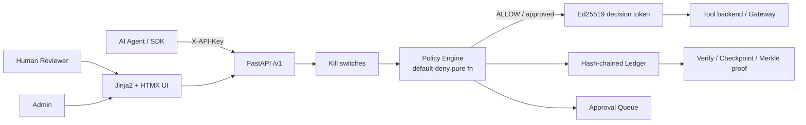

# AgentWarden

**AI Agent Governance and Human Accountability System**

[](https://github.com/CodeMudit/AgentWarden/actions/workflows/ci.yml)

AI agents are being given real authority (refunds, emails, data access), but nobody can reliably answer: *was this action allowed, under which rule, which human is responsible, and can the record be trusted?*

AgentWarden is a governance layer that sits between AI agents and the tools they use. Before an agent performs a risky action it asks AgentWarden. A **deterministic, default-deny** policy engine answers **ALLOW**, **DENY**, or **REQUIRE_APPROVAL**. Risky requests wait in a human reviewer queue. Every event is written to an **append-only, hash-chained ledger** that anyone can re-verify, and every agent has a **named human owner**. Approvers must give a written reason, and **nobody can approve their own agent's actions**.

Built for **CodeX 3.0** (problem statement: AI Agent Governance and Human Accountability System).

> **No LLM ever makes or changes a decision.**  
> Rules decide. An optional Anthropic key may only reword plain-language summaries of pending requests.  
> The app works fully without any API key.

---

## 60-second demo

```text
1. Agent tries a direct tool call          → blocked (no decision token)
2. Governed small refund ($40)             → ALLOW, token issued
3. Large refund ($900)                     → REQUIRE_APPROVAL
4. Non-owner reviewer approves with reason → token issued
5. Agent tries to alter params after approval → blocked (param hash mismatch)
6. Export evidence bundle, tamper one byte → offline verifier flags exact seq
```

Full judge script: [`docs/DEMO_SCRIPT.md`](docs/DEMO_SCRIPT.md)

```bash
make demo   # reset, seed, start server, print credentials + URLs
```

| Email | Password | Role |
|-------|----------|------|
| admin@demo.local | demo-admin-pass | admin |
| reviewer_a@demo.local | demo-reviewer-pass | reviewer (owns refund-bot) |
| reviewer_b@demo.local | demo-reviewer-pass | reviewer (owns email-assistant) |
| auditor@demo.local | demo-auditor-pass | auditor (read-only) |

---

## Architecture



1. Agent calls `POST /v1/actions/request` with `X-API-Key`.
2. Kill switches (agent suspended / system frozen) checked first.
3. Pure policy engine evaluates rules (lowest priority number wins; no match → DENY).
4. Result stored; ledger entries `action_requested` + `decision_made` (+ `approval_requested` if pending).
5. On ALLOW or human approval, a short-lived single-use **decision token** is issued binding action, agent, tool, and params hash.
6. Tool backends (or the gateway) refuse any call lacking a valid, unconsumed token.
7. Reviewers approve/reject with written reasons; separation of duties enforced in the service layer.
8. Parameter hash is re-checked at completion / token use (closes TOCTOU).

**Stack:** Python 3.12, FastAPI, SQLAlchemy 2, Alembic, SQLite (default) / PostgreSQL, Jinja2 + HTMX + Tailwind + Alpine (CDN), argon2, Ed25519 (PyNaCl), pytest, Docker.

---

## Quickstart

```bash
python3 -m venv .venv && source .venv/bin/activate
pip install -r requirements.txt && pip install -e .
cp .env.example .env

# Seed demo data (users, agents, policy, ~50 historical actions)
PYTHONPATH=. python scripts/seed.py --reset

# Run
uvicorn app.main:app --reload --port 8000
# → http://localhost:8000/login
```

```bash
# Tests
PYTHONPATH=. python3 -m pytest -v

# Smoke test (server must be running after seed)
make verify

# Docker (app + Postgres)
docker compose up --build
```

---

## Features

| Capability | What it does |
|------------|--------------|
| **Default-deny policy engine** | Pure function; rules only; no LLM decisions |
| **Human approval queue** | Written reasons; separation of duties (owner cannot approve own agent) |
| **Decision tokens** | Ed25519-signed, short-lived, single-use; bind action + params hash |
| **Gateway mode** | AgentWarden invokes registered tools only after a decision allows it |
| **Param-bound approvals** | Approved params hash checked at execution (TOCTOU closed) |
| **Hash-chained ledger** | SHA-256 chain; Ed25519-signed checkpoints; Merkle inclusion proofs |
| **Evidence export** | Offline-verifiable bundle (`scripts/verify_bundle.py`, zero app deps) |
| **Kill switches** | Per-agent suspend + system freeze |
| **Policy simulator** | Dry-run proposed policy against recent actions before activation |
| **Named human owners** | Every agent has an accountable owner |
| **SDK + MCP proxy** | Minimal agent code changes; governance at the tool boundary |

---

## Threat model

See **[docs/THREAT_MODEL.md](docs/THREAT_MODEL.md)** for assets, actors, attacks, mitigations, and residual risk.

**Honest limitations (what we do *not* claim):**

- The ledger is **tamper-evident**, not tamper-proof. Full DB rewrite is detectable only with external checkpoints / anchoring.
- Agents that never call AgentWarden and tools that never verify tokens are outside the trust boundary.
- Sensitivity is currently self-declared by the agent (server-side classification is future work).
- Demo credentials are for local/hackathon use only.
- No multi-tenancy, OAuth, or Slack in this scope.

---

## Comparison

| Approach | Deterministic? | Human accountability? | Tamper-evident record? | Closes agent bypass? |
|----------|----------------|----------------------|------------------------|----------------------|
| Prompt “ask a human” | No | Weak | No | No |
| Cloud IAM on tools | Partial | Role-based only | Provider logs | If tools enforce IAM |
| Logging-only AI gateway | N/A | After-the-fact | Mutable logs | No |
| **AgentWarden** | Yes | Named owners + SoD + reasons | Hash-chained ledger | Tokens + gateway |

---

## API sketch

```bash
# Request action
curl -s -X POST http://localhost:8000/v1/actions/request \
  -H "X-API-Key: $REFUND_BOT_KEY" -H 'Content-Type: application/json' \
  -d '{"tool":"issue_refund","params":{"amount":40},"sensitivity":"internal"}'

# Verify decision token (tool backend)
curl -s -X POST http://localhost:8000/v1/tokens/verify \
  -H 'Content-Type: application/json' \
  -d '{"token":"..."}'

# Export evidence bundle
curl -s http://localhost:8000/v1/ledger/export -o evidence.json
python scripts/verify_bundle.py evidence.json
```

---

## Development

Maintainer notes and session log: [`docs/DEVLOG.md`](docs/DEVLOG.md)

```bash
make setup   # venv + deps
make test    # pytest
make lint    # ruff check + format
make seed    # seed demo data
make verify  # end-to-end smoke test
```

---

## License

MIT — see [LICENSE](LICENSE).
